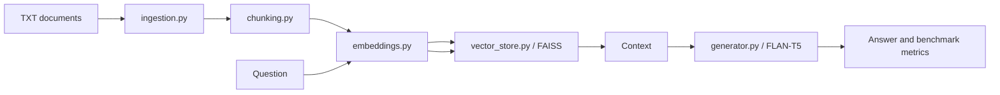

# Architecture

`ingestion.py` loads UTF-8 `.txt` files and assigns the filename stem as
`doc_id`. `chunking.py` creates word-based chunks while preserving `doc_id`
and source metadata. `embeddings.py` uses normalized
`all-MiniLM-L6-v2` vectors. `vector_store.py` stores those vectors in a
FAISS `IndexFlatIP` index and keeps chunk metadata in the same insertion
order. `generator.py` uses `google/flan-t5-small` on CPU.

`main.py` is the interactive baseline workflow. `demo.py` shows baseline,
deletion, and prompt constraint. `run_benchmark.py` builds a fresh synthetic
index for every test. Hard deletion filters the target chunks, creates a new
FAISS index, and re-embeds only remaining chunks. Prompt constraint leaves the
target vector available and adds a disclosure instruction to generation.

The deletion boundary is the active retrieval corpus. It is intentionally
called document/index deletion rather than model-weight unlearning.
